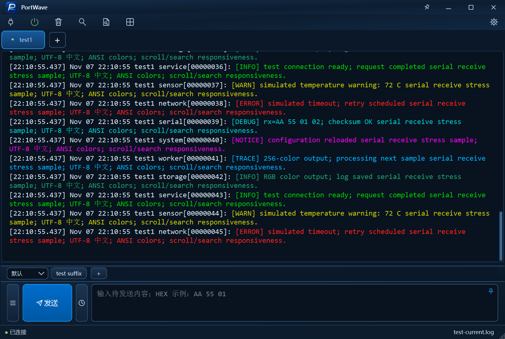
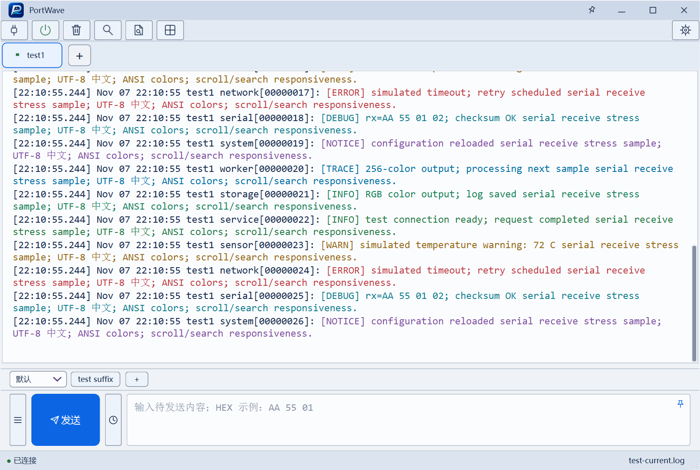

# PortWave

A Windows serial & TCP terminal with independent log workspaces, ANSI colors and incremental log refresh.

[下载最新版](https://github.com/flowswave/PortWave/releases/latest) · [构建说明](#构建与测试) · [功能与限制](docs/parity.md) · [GPL-3.0-only](LICENSE)

面向 Windows 的多连接串口与 TCP 调试工具，使用 **C++20、Qt 6 Widgets 和 QScintilla**。将连接调试、持续日志存盘和独立日志阅读工作区集中在一个桌面应用中。

默认使用炫彩主题、紧凑控件和 12 pt 字号；也提供明亮主题，字体、颜色和控件风格按主题保存。

## 界面

### 炫彩主题



### 明亮主题



截图使用模拟连接与测试日志，不包含真实设备数据。

## 功能

- **连接与收发**：多串口/TCP 连接、连接标签与分屏、文本/HEX/混合显示、UTF-8 与 ANSI 彩色日志、显示暂停和有界接收/发送队列。
- **发送工具**：发送草稿、CR/LF 后缀、当前行发送、定时发送、发送历史、快捷命令组和 TXT 导入/导出。
- **日志存盘**：时间标签、文件分卷、默认开启的纯文本存盘；可保留原始控制码。显示暂停不停止后台存盘。
- **日志阅读**：多个独立工作区、多文件标签、浮窗、位置恢复、手动/自动增量刷新。刷新只追加源文件尾部，不重载已有正文；文件被截断/替换时保留当前内容并提示重新打开。
- **查找与标记**：普通、扩展和正则搜索，当前/多个文件范围，历史结果分组、结果定位、八组文字标记和搜索高亮。
- **配置与诊断**：设置暂存/应用/取消、连接配置、工作区归档、快捷键、限量诊断文件；另有升级协议实现和模拟连接供回归测试。

这是从旧 Python 版迁移而来的独立工程，配置与参考版本隔离。完整迁移状态和未验证功能见 [迁移对照](docs/parity.md)，不要将“已实现”理解为所有串口设备均已实机验收。

## 下载与运行

构建后的 `release/` 只按交付形式分为两类：

```text
release/
├─ portable/
│  ├─ PortWave/                         # 解压后直接运行的完整目录
│  │  ├─ PortWave.exe
│  │  ├─ *.dll、platforms/、licenses/ …
│  └─ PortWave-0.1.0-win64-portable.zip
├─ installer/
│  └─ PortWave-Setup-0.1.0-x64.exe
└─ SHA256SUMS.txt
```

**绿色版**：解压 ZIP 后运行 `PortWave/PortWave.exe`，保留同目录 DLL 和插件，无需安装 Qt。这里的“绿色”指免安装，用户配置仍保存到 Windows 用户配置目录，不写入程序目录。

**安装版**：退出旧实例后运行安装程序，默认安装到 `C:\Program Files\PortWave`，需要管理员权限，创建开始菜单和卸载入口；更新/卸载保留用户配置与日志。安装版与绿色版使用同一个 MSVC Release 程序。

```powershell
.\release\portable\PortWave\PortWave.exe --demo
.\release\portable\PortWave\PortWave.exe "D:\Logs\example.log"
```

日志阅读目前以 UTF-8 为输入；首次打开加载完整内存文档，大文件没有固定打开上限，但受可用内存限制。200 MiB 起启用减少颜色/换行开销的模式。它不是磁盘分页查看器，也不对 GB 级文件速度作未经测量的承诺。

## 开发环境

当前维护和交付工具链统一为 **Windows x64 / MSVC v143 / Qt 6.8.3 msvc2022_64**，不再安装或构建 MinGW。工具不放入工程目录：

```text
C:\Program Files\PortWaveToolchain\
├─ VSBuildTools/                    # VS 2022 C++ workload / Windows SDK
├─ Qt/6.8.3/msvc2022_64/
├─ python/                         # CMake、Ninja、aqt、clang 工具
└─ nsis-3.11/                      # 安装包编译器
```

| 工具 | 固定版本/用途 |
|---|---|
| MSVC | v143，C++20；Windows SDK 10.0.26100.0 |
| Qt | 6.8.3：Widgets、Network、SerialPort、Concurrent、PrintSupport、Svg、Test |
| QScintilla | 2.14.1，固定上游源码，通过 EditorInterface 使用 |
| miniz | 3.1.2，配置归档 |
| CMake / Ninja | 4.4.4 / 1.13.2 |
| clang-format / clang-tidy | 23.1.3 / 23.1.4 |
| NSIS | 3.11，Windows 安装包 |

依赖版本、来源和归档校验值见 [dependencies.json](third_party/dependencies.json)，许可见 [docs/licenses.md](docs/licenses.md)。不修改第三方源码以隐藏构建问题。

新机器先安装位于 Program Files 下的 Python 3.12，以及 VS 2022 Build Tools 的“使用 C++ 的桌面开发”和 Windows SDK；随后在管理员 PowerShell 中安装固定依赖：

```powershell
.\scripts\install-msvc.ps1
.\scripts\dependencies.ps1 -Python 'C:\Program Files\Python312\python.exe'
```

初始化工具需要管理员权限；日常配置、编译、测试和打包无需管理员权限。脚本默认使用上述 Program Files 目录，可用进程环境变量 `PORTWAVE_TOOLCHAIN_ROOT` 指定另一套完整工具环境。不会修改系统全局 PATH。

## 构建与测试

从工程根目录使用 PowerShell 执行（支持 Windows PowerShell 5.1 和 PowerShell 7）：

```powershell
.\scripts\environment.ps1
.\scripts\configure.ps1 -Preset msvc-release
.\scripts\build.ps1 -Preset msvc-release -Jobs 6
.\scripts\test.ps1 -Preset msvc-release -Suite release
```

`out/build/msvc-release/src/app/PortWave.exe` 是开发构建，运行时需要 SDK 环境；实际分发使用 `release/` 中已部署运行库的版本。

生成两种交付物及 SHA256 校验文件：

```powershell
.\scripts\release.ps1                 # 配置 → 编译 → 发布回归 → 绿色版/ZIP → 安装包
.\scripts\release.ps1 -Clean          # 清除 Release 编译目录后完整重建
```

也可分别执行 `package.ps1` 和 `installer.ps1`。Debug 使用 `msvc-debug`；纯标准 C++ 核心使用 `core-debug`，不需要 Qt 参与构建：

发布已提交版本时，再运行 `scripts/package-sources.ps1 -Ref HEAD` 生成完整项目源码和 Qt 依赖源码附件，并更新四个附件的 SHA256 校验文件。此步骤要求源码已提交且工作区干净，归档中包含固定版本的 QScintilla/miniz 源码。

```powershell
.\scripts\configure.ps1 -Preset core-debug
.\scripts\build.ps1 -Preset core-debug
.\scripts\test.ps1 -Preset core-debug
.\scripts\format.ps1 -Check
.\scripts\analyze.ps1 -Preset msvc-release
```

发布回归包含核心测试、当前支持行为的 Qt 专项和程序启动检查；`-Suite all` 额外运行历史完整集。历史集仍有旧三主题/暂停按钮预期和共享状态栏用例问题，保留用例并在 [验证记录](docs/validation.md) 中跟踪，不将发布子集通过描述为全量测试通过。真实硬件、持续压力和管理员安装/卸载验证单独记录。GitHub Actions 的核心测试不代表 Windows GUI 或硬件验收。

## 清理构建文件

```powershell
.\scripts\clean.ps1 -WhatIf                # 预览默认清理范围
.\scripts\clean.ps1                        # 删除编译、打包中间目录，保留日志和 release
.\scripts\clean.ps1 -Preset msvc-release   # 只删除一个构建配置
.\scripts\clean.ps1 -All                   # 删除整个 out（含测试记录和临时备份）
```

清理脚本限制在工程 `out/` 中，拒绝越界路径和重解析点，不删除源码、Program Files 工具链、发布成果或用户配置。需要重新生成 CMake 缓存时也可用 `configure.ps1 -Fresh`；只清目标文件可用 `build.ps1 -CleanFirst`。

## 源码结构

```text
src/
├─ app/              # 进程入口、命令行、Windows 图标/版本资源
├─ ui/               # 主窗口与设置页、主题、资源、界面绑定
├─ features/         # 终端与日志工作区、查找、标签、分屏与窗口协调
├─ editor/           # EditorInterface 与 QScintilla 适配器
├─ services/         # 会话门面、异步文件读取与搜索
├─ infrastructure/   # 连接工作线程、存盘、配置及工作区归档
└─ core/             # 纯 C++20：协议、CRC、命令、ANSI、有界队列
tests/               # 核心及 Qt 行为回归
benchmarks/          # 核心算法性能测量
cmake/               # 第三方 target、MSVC 依赖发现
scripts/             # 环境、构建、验证、打包和清理入口
installer/           # NSIS 安装/卸载定义
third_party/         # 固定依赖、上游原始源码和许可
docs/                # 架构、ADR、功能对照、验证与真实 UI 截图
out/                 # 可重新生成的构建和测试文件（不提交）
release/             # 用户交付物（不提交）
```

依赖方向为 `app → ui → features → services → infrastructure → core`；编辑能力经 `EditorInterface` 暴露。`core` 不依赖 Qt；QWidget 只在 GUI 线程操作，连接与文件任务可异步取消。细节见 [架构](docs/architecture.md)、[设计决策](docs/decisions/) 和 [协作规则](AGENTS.md)。

## 贡献与许可

修改前先确认所属模块；修复行为问题增加有效回归，界面调整查看真实截图，架构改变补充 ADR。使用 UTF-8 和仓库 clang-format，构建目录、SDK、用户数据及发布二进制不进入源码提交。项目脚本不会自动初始化版本库或提交代码。

本项目自有代码和维护者授权发布的界面资源采用 **GPL-3.0-only**，完整条款见 [LICENSE](LICENSE)。第三方组件仍按各自许可分发，其原始版权与许可声明保留；详情见 [第三方声明](THIRD_PARTY_NOTICES.md)、[许可说明](docs/licenses.md) 和 [源代码获取](docs/SOURCES.md)。

QScintilla 2.14.1 与 miniz 3.1.2 的原始源码包含在 `third_party/`；Qt 的固定版本来源和模块源码下载地址见源代码说明。首次公开版本建立独立历史，不包含私人开发记录、SDK、编译缓存或真实设备日志。
